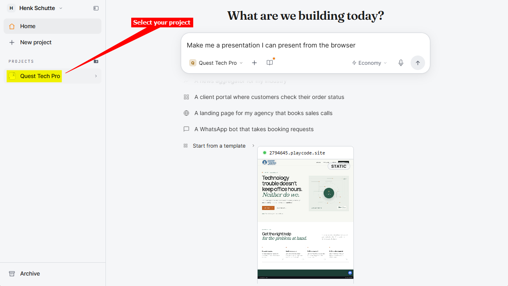
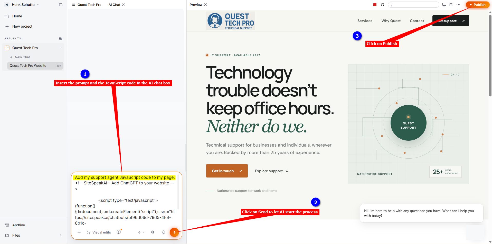
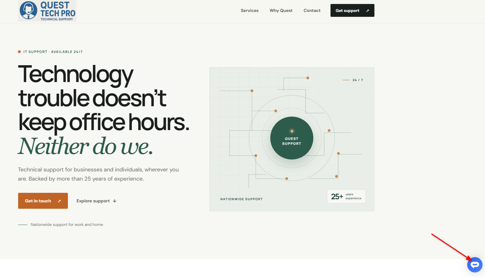
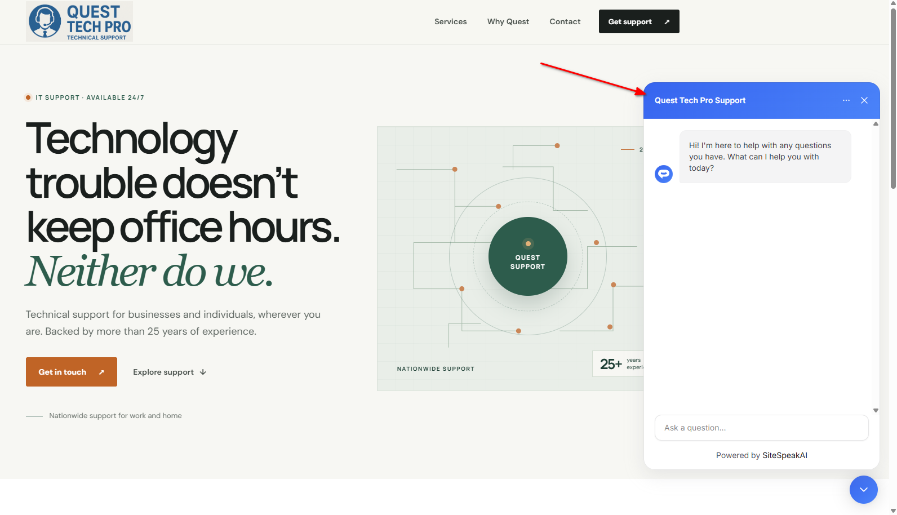

import InstallCopyCode from '/snippets/install-copy-code.mdx';
import Cta from '/snippets/cta.mdx';

You want to embed your custom trained AI support agent in your **Playcode** website page. Here's how to add an AI support agent to Playcode with SiteSpeakAI.

**Playcode** is an AI-powered platform for building, hosting, and running websites, web apps, and mobile apps through conversational prompts. 

**Website URL**: [PlayCode](https://playcode.io)

## Add your AI support agent to your **Playcode** website

<InstallCopyCode />

### In Playcode

1. Log into your **Playcode** account and on your dashboard select the project you want to edit.

**Note**: Adding custom code to your **Playcode** website page is done via the Playcode AI chat option. 

2. Create your AI prompt and add it to the AI chat box. Click on **Send** to instruct the Playcode AI agent to add your custom code to your website. After the process completes, click on **Publish** to publish your changes to your live website page.

3. Your AI support agent button will now be displayed on your **Playcode** website page

4. If you click on the button it will display the AI support agent dialogue

Your AI support agent has now been added to your **Playcode** website and your visitors/customers can start interacting with it!

<Cta />
